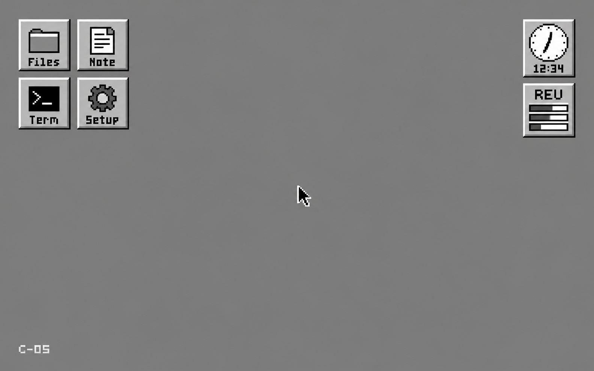

# C-OS · Commodore OS

**8-bit roots. Bigger ideas.**

What if a C64 had 16 MiB of linear app memory, preemptive multitasking, and a tiny desktop?

C-OS is an OS experiment for the **C64 Ultimate**, targeting its 64 MHz turbo mode and 16 MiB REU. A compact 6510 assembly kernel runs a small register VM; apps use **C-Script**, a simple compiled language. Rust is the recommended choice for the host compiler and tooling.

The plan:

- Linear 24-bit app addresses, with REU transfers handled by the kernel.
- Opcode fuel for preemption, with separate video deadlines.
- A 320×200 UPIC desktop inspired by NeXT: movable square icons, five shell tones, no fixed bars.
- Integers, float24 and float32; simple APIs for graphics, files, SID and Ultimate Audio.

**Current stage: reviewed specifications.** The implementation comes next; hardware timing and memory budgets still need validation.

→ [Start with the specification](specs/SPEC.md) · [C-Script](specs/LANGUAGE.md) · [Ultimate API](specs/ULTIMATE-API.md) · [Numerics](specs/NUMERICS.md)

*UI concept, not an implementation screenshot. [Explore the mockups](specs/ui/PROMPTS.md).*

License: **to be decided**.
