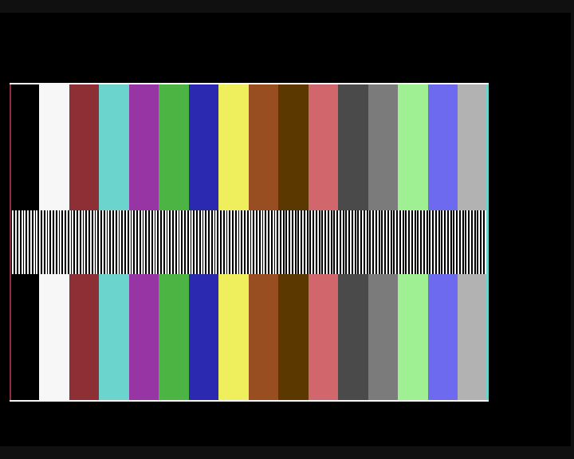

# M0 hardware diagnostics and RAM budget

M0 is functionally verified on the supplied UE2/TRX64 backend. Physical timing
qualification remains pending. This is a static diagnostic display and hardware
probe, not the native VM, kernel scheduler, or interactive desktop.

The measurements retained here describe the original M0 delivery. M2 rebuilt
and reran all ten profiles after changing timer snapshots to coherent
high-low-high reads. Its [current regression evidence](m2.md) records the new
probe/tag and baselines; original artifacts are not used to prove that build.

All native code is original NMOS 6502/6510 assembly. The neighboring GPL renderer
was inspected as a reference; no source, font, or bitmap was incorporated.
C-OS's license remains undecided. The external emulator is run as a separate
developer tool and is not bundled or linked into C-OS.

## Build from an independent clone

Install Java and obtain **Kick Assembler 5.25** from
[the author's site](http://theweb.dk/KickAssembler/). Put `KickAss.jar` in
`toolchain/KickAss.jar`, or supply `KICKASS_JAR`. The build verifies SHA-256
`9592a39336e73a1db8b4a7749256d62d29b113b1c7f0f6c86ea43870ebd9ae1f`.
It never downloads tools. Python uses only the standard library.

```sh
python3 scripts/m0.py
python3 -m unittest discover -s tests/native -v
```

Explicit overrides used during development:

```sh
KICKASS_JAR=/Users/frenchfaso/Documents/Code/C64/toolchain/kickassembler/KickAss.jar \
JAVA=/Library/Java/JavaVirtualMachines/temurin-25.jdk/Contents/Home/bin/java \
python3 scripts/m0.py
```

Output in `build/m0`:

| File | Meaning |
|---|---|
| `probe.prg` | Conventional `$0801` BASIC loader, `SYS 4608` |
| `renderer.prg` | Separate `$F000` segment; never load as one flat bootstrap PRG |
| `diagnostic.reu` | Exactly 16,777,216 bytes, `COSREU01`, ABI 1, zero apps |
| `pattern.columns` | Independent host expectation for all 160 framebuffer pages |
| `map.json`, `map.txt` | Sizes, bounds, reservations, symbols, build tag and hashes |
| `*.vs`, `*.sym`, `*.assembly.log` | Native symbol/map and assembler diagnostics |

The bootstrap and header share a deterministic build tag. The renderer is stored
at REU `$001000` and fetched into `$F000` before scanout starts. The PRG only spans
`$0801–$1782`; it never passes through `$D000–$DFFF`. Its 3,970-byte load payload
includes BASIC and zero padding; those bytes are not all resident kernel code.
The REU test addresses are `$000040 + bank*65536` and the 256-byte benchmark range
`$004000–$0040FF`. All affected bytes are saved, restored and checked.

## Probe behavior

The probe banks ROM out with `$01=$35`, disables unnecessary CIA IRQs, clears
decimal mode, establishes the stack and installs a minimal startup NMI handler.
It counts the nine-bit raster to reject non-PAL targets. It measures executed CPU
work per line at the requested slow and fast settings. Reading `$D031` is not the
speed check. The fast count must be 640–767 iterations for this loop/profile;
the observed 64 MHz backend count is 704, while lower-speed profiles are rejected.
It retries for up to 250 PAL frames (approximately five seconds) for startup
settling. This envelope is an initial profile discriminator, not a calibrated
frequency meter; physical validation must confirm it on the selected firmware.

The alias test first saves all 256 original bank bytes, then writes unique bank
tags, reads them, restores all saved bytes and verifies restoration. Saving every
value before writing is essential: aliases have the same original value. The
probe reports the capacity in 64 KiB banks and accepts only 256 banks. The
supported Ultimate sizes below 16 MiB are explicitly rejected after restoration.
A missing REU and a mismatched PRG/pack are errors. Benchmark restoration errors
also stop startup before the display is enabled.
Capacity fields are meaningful only when a REU responds; E3 on an absent device
does not turn the residual count into a measured capacity.

The 80-byte report starts at `$0300`:

| Offset | Value |
|---|---|
| `00–03` | ASCII `M0R1` |
| `04` | `01` running; `E1` PAL error; `E2` speed error; `E3` REU/restore error; `E4` pack mismatch |
| `05–06` | Raster lines, little-endian u16 |
| `07–08`, `09–0A` | Slow/fast executed loop counts |
| `0C–0D` | REU capacity in 64 KiB banks |
| `0E`, `0F` | Restore error, alias/tag mismatch |
| `10–11`, `12–13` | Scanouts, missed synchronizations |
| `14–15` | NMI count |
| `16–17`, `18–19` | Deferred admissions, completed runtime FETCH/STASH pairs |
| `1A–1B` | Runtime DMA ending in an active line (must remain zero) |
| `1C` | Maximum observed hardware-stack usage in ordinary probe/IRQ paths |
| `20–4F` | 12 records: u16 minimum / u16 maximum CIA PHI2 ticks |

The timing records are setup baseline, timer baseline, FETCH of 1/16/64/128/256
bytes, and STASH of 1/16/64/128/256 bytes. Each record uses 16 samples. Timer force
load is allowed to settle across a PHI2 edge before the first sample; otherwise a
64 MHz read can precede the reload and yield a false negative duration. Samples
include the timed driver path and timer-read overhead; resolution is one PHI2
tick, not one turbo CPU cycle. Zero-length software transfers return without a
command-register write; hardware length zero is never used for an empty request.

## Geometry and raster admission

The renderer reads exactly 160 packed columns, with even pixels in the low
nibble and odd pixels in the high nibble. Columns 0–143 use `$4000–$CFFF`; columns
144–159 use `$E000–$EFFF`. Every column reserves 256 bytes; rows 200–255 are zero
and undisplayed. Twenty immediate loads are prepared per line. The pixel stream
costs **2,520 CPU cycles**; preparation costs **160 CPU cycles**. Every eighth
pair has a shortened load to account for the 63 delivered slots per PHI2 on the
nominal 64 MHz profile. The final high pixel has four extra delay cycles.

The diagnostic contains one-pixel white top/bottom edges, red left/cyan right
edges, sixteen 20-pixel color bars, and alternating white-even/black-odd pixels
on rows 80–119. The screenshot validator checks 320 individually visible stripe
pixels, all 64,000 source pixels in both output rows, all sixteen distinct palette
indices, and all four edges. The firmware controls RGB values; the normative
palette values remain C64 indices.

The active interval is PAL raster **60–259 inclusive**. The IRQ is armed at 58
and resynchronizes each line. No VM runs, and no REU DMA starts, during scanout.
The startup tests and renderer load happen before the raster is installed.

Runtime test DMA is conservatively admitted only on lines **280–299**, with IRQs
disabled for a second admission check and the bounded FETCH/STASH pair. Each
direction's observed 128-byte maximum must be below 512 PHI2 ticks. Even at the
latest admission, at least 70 complete lines remain before the next line-58
guard; two 511-tick transfers occupy under 17 lines. Normal measured pairs take
260 ticks (about 4.13 PAL lines). This is deliberately narrower than the future
kernel service window. Observed maxima and a large margin do not establish a
physical worst-case bound; device qualification must include interference.

The IRQ preserves A/X/Y. Raster scratch is separate from driver scratch. An NMI
preserves A, records a recovery request/counter, and scanout resynchronizes on the
next frame. Opening the firmware menu or injecting NMIs may disturb a frame;
disturbance-free output during such operations is not claimed.

The default line-delay parameter is 140. It is verified for the recorded emulator
profile below. Its physical horizontal phase remains provisional; use
`--line-delay N` to produce a separately tagged build during device calibration.
No delay inherited from a 384-pixel source is treated as qualified hardware data.

## RAM budget

| Item | Actual emitted / runtime bytes | Existing reservation |
|---|---:|---:|
| Probe code and constant data | 1,411 assembled | 11,776 resident area |
| Renderer, including alignment padding | 2,289 assembled | 2,560 renderer area |
| Driver / raster scratch | 17 / 2 runtime | 64 / 64 |
| Nibble table | 256 generated at runtime | 256 |
| Report | 80 runtime | 256 global state |
| DMA staging / saved values | 512 runtime | 512 |
| Hardware stack | 10 observed; 18 conditional static bound | 256 |
| Vectors | 6 runtime | 6 |
| Framebuffer | 40,960 runtime, 32,000 displayed bytes | 40,960 |
| Visible I/O window | No ordinary RAM | 4,096 |

The 20,480 bytes outside framebuffer and visible I/O include code, tables,
structures, cache, stack and scratch. PCBs, event rings, code/data caches, font,
cursor and desktop metadata remain **future reservations**, not implemented
modules. The resident area has 10,365 bytes beyond the assembled probe. The
numeric target of 4,096 bytes belongs inside that remaining native budget; it is
not additional memory. This report does not prove that the finished kernel fits.

The stack measurement samples the actual stack pointer at nested DMA setup and
IRQ entry, including the IRQ's unconditional two-byte renderer call. The normal
backend workload observed 10 bytes. The conservative 18-byte bound includes one
IRQ and one NMI on the deepest call chain; arbitrary recursive NMIs are outside
that bound. Physical disturbance tests must record their own high-water value.

The REU is one shared 16 MiB resource. The specified system reservation is
262,144 bytes, leaving **16,515,072 bytes (15.75 MiB)** for future app arenas.
This diagnostic does not allocate those arenas or implement storage/surfaces.

## Reproduce backend qualification

Provide an external UE2 executable plus firmware config, flash and settings.
The adapter copies flash into its output directory, creates a private USB REU
image with nonzero sentinels, and uses the firmware's REU preloader. It leaves the
supplied files and neighboring checkout untouched. All generated USB caches stay
under the chosen output directory. No backend is required for normal compilation.

```sh
python3 scripts/m0_ue2.py \
  --emulator /path/to/ue2emu \
  --config /path/to/c64u.toml \
  --flash /path/to/flash.bin \
  --settings /path/to/ultimate.cfg \
  --suite
```

The suite includes the PAL/64 MHz/16 MiB display, 128 KiB/512 KiB/2 MiB/8 MiB
aliases, absent REU, 32/48 MHz manual turbo, NTSC and a mismatched pack. It compares
physical DDR snapshots before/after the native probe, including untouched banks,
and the benchmark range. The emitted pack remains unchanged: the executed
sentinel copy has its own recorded SHA-256. A failed run removes its prior result
so stale successful JSON cannot accompany a new failed capture.

The adapter's automated screenshot geometry check currently qualifies the PAL
720×576 output profile, with 15/8 horizontal scaling and two output rows per
source line. Other output modes require a qualified geometry adapter or direct
source-video capture; this does not change the 320×200 native renderer.

## Recorded emulation results, 2026-10-10

The saved [positive result](m0-evidence/result.json),
[ten-case suite](m0-evidence/suite.json), [memory map](m0-evidence/map.json),
[readable budget](m0-evidence/map.txt) and [provenance](m0-evidence/provenance.json)
belong to build tag `$E5B09CE4`. Five native contract tests passed, including an
injected publication failure that restored the prior artifact set. A second
complete build produced identical hashes for all four artifacts and `map.json`.

The supplied UE2 executable SHA-256 is
`c6a59402c2fd8a09199c5f1d825cfa50b89995b9a7f6e2e089f6b4bcd90cf225`.
The inspected checkout was at `512883433e93b7cfbf224a01ae5e91b29600c2cf`, with
TRX64 upstream reference `v0.11.0 / ab01fbc56304dd37179bcb469100f187684472ab`.
The binary hash identifies the executed backend; the checkout revision alone
does not establish which sources produced that binary. Firmware identified
itself as **C64 Ultimate (V1.01) 1.1.0**. Firmware, configuration, flash, settings,
artifact and evidence hashes are retained in the provenance file.

| Profile | Expected and observed status | Independent REU preservation |
|---|---|---|
| PAL, register-controlled 64 MHz, 16 MiB | `01`; 312 lines, 256 banks, fast count 704 | Passed |
| 128 KiB / 512 KiB / 2 MiB / 8 MiB REU | `E3`; 2 / 8 / 32 / 128 banks | Passed for every profile |
| REU disabled | `E3` | Passed |
| Manual 32 / 48 MHz | `E2`; fast count 368 / 528 | Passed |
| NTSC | `E1` | Passed |
| Header build tag altered | `E4` | Passed |

Both directions produced these CIA PHI2 tick minima/maxima over 16 samples:

| Bytes | FETCH min / max | STASH min / max |
|---:|---:|---:|
| 1 | 3 / 3 | 3 / 3 |
| 16 | 18 / 18 | 18 / 18 |
| 64 | 66 / 66 | 66 / 66 |
| 128 | 130 / 130 | 130 / 130 |
| 256 | 258 / 258 | 258 / 258 |

The setup baseline was 1–2 ticks and the timer baseline 0–0 ticks. The observed
transfer path fits `ticks = 2 + bytes` for FETCH and STASH on this backend. This
measures the path's intercept and slope, including command/timer overhead; it
does not isolate hardware startup latency or establish physical bandwidth.
The positive 2,000 ms sample, including startup, reported 90 scanouts and 450
runtime DMA pairs, zero missed synchronizations, zero active-line DMA violations,
zero restoration errors and a 10-byte observed hardware-stack high-water.
These counters are a functional sample, not a steady-state frame-rate claim.



The capture contains all 320×200 source pixels, including both boundary pixels,
at output rectangle `x=12, y=104, width=601, height=400`. Each source line occupies
two output rows. The checker matched all 64,000 source pixels in both rows and
resolved 320 distinct stripe pixels. The screenshot SHA-256 is
`70cefe5734301e9fd1c7c80055b428be57bc32435beedc5119bb7aab70977dfb`.
Its left-aligned horizontal phase is the qualified emulator setting; physical
phase calibration remains pending.

## Physical procedure still required

1. Record exact machine model, firmware/FPGA revisions, PAL mode, turbo control,
   CPU speed, badline settings, output crop/scaling/palette, REU size and attached
   devices. Retain build map and artifact SHA-256s.
2. Select PAL, 16 MiB REU, and register-controlled nominal 64 MHz turbo. Load the
   exact `diagnostic.reu` via the Ultimate file menu's **Load into REU** action,
   then load/run `probe.prg` (`SYS 4608` if started manually). A pack mismatch must
   produce E4. REU loading is a pre-boot procedure, never an OS syscall.
3. Capture the `$0300–$034F` report through a monitor or saved memory dump. Confirm
   312 lines, accepted measured speed, 256 banks and zero restoration errors.
   Repeat with 128/512 KiB and 2/8 MiB settings; each must reject after preserving
   independently seeded bytes. Repeat absent REU and lower/manual turbo profiles.
4. Capture the VIC video stream without smoothing. Resolve all 320 alternating
   pixels, one-pixel edges and all 200 rows. Confirm palette order. If necessary,
   rebuild the line delay, retaining the build tag and map for every trial.
5. Record every FETCH/STASH minimum/maximum and timer/setup baseline. Repeat with
   cold/warm state, storage activity and the hardware profile's relevant memory
   contention. Fit startup cost and length slope separately for each direction;
   retain raw results. Do not multiply REU bandwidth by the turbo ratio.
6. Run the diagnostic for at least ten minutes. Confirm advancing scanout/DMA
   counters, zero missed synchronizations and zero active-line DMA violations.
   Use a logic/video capture to check DMA completes before synchronization;
   post-transfer raster samples alone cannot certify unobserved bus stalls.
7. Inject a bounded NMI and open/close the firmware menu. Record disturbances and
   recovery, stack high-water and counters. Qualify guard margin and transfer
   lengths on this device before reusing the admission policy in M2/M3.

M0 remains partially qualified until the physical steps pass. M1 can proceed
independently. The next native step is M2: add the 6510 dispatcher and compare its
architectural state against the host VM, while updating this cumulative budget.
